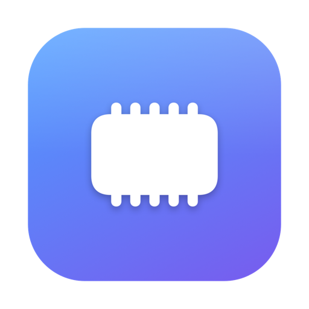

<div align="center">



# 記憶體管家 MemoryButler

**為小記憶體 Mac 而生的智慧管家——自主監控、自主決策、自主釋放，讓 8GB 的 Mac 也能順暢運作。**

[English](README.md) | [简体中文](README.zh-CN.md) | **繁體中文**


[](https://github.com/xiewei3536/MemeryButler/releases/latest)


</div>

---

## 為什麼需要它

8GB 記憶體的 Mac 常常在交換空間和壓縮記憶體之間掙扎,整台機器越用越卡。記憶體管家是一個極輕量的原生選單列 App,即時監控記憶體壓力,**在對的時機自動出手釋放記憶體**——不用點按、不用 root 密碼、不是臃腫的 Electron(它自己常駐僅約 35MB)。

## 功能特色

- 🐢 **卡頓偵測**——找出真正讓 Mac 變慢的原因,一句話講清楚:佔滿 CPU 的程式(例如卡住的同步程式連續一小時 90%)、此刻正從磁碟讀回記憶體(MB/s)、CPU 過熱降速、Intel 內顯接高更新率外接螢幕、連續開機多天且交換空間好幾 GB。標題列直接顯示一個判斷:順暢/有點卡/很卡
- 🛠 **一鍵處理**——失控的程式可以降到背景(免 root、可還原,切換到該 App 時自動恢復)、重新啟動或結束。選單列程式與 Apple 的背景工作程序(Spotlight、Siri 建議、照片分析)連續 5 分鐘佔滿 CPU 會被自動壓制,一閒下來就恢復——絕不碰 Dock 上的 App、系統介面、通話、遠端桌面、錄影與 VPN——10 分鐘後還會通知你
- 🧠 **智慧自主釋放**,三重觸發、全部可調:
  1. **核心壓力訊號**——macOS 回報記憶體壓力的瞬間立即反應
  2. **可用門檻**——可用記憶體低於 20%(可調)並持續 30 秒
  3. **定時排程**——每 15 分鐘到 2 小時,喜歡固定節奏也可以
- 📈 **自適應冷卻**——釋放成效差(系統真的很忙)就自動加倍退避,不做無效空轉;成效好則恢復正常節奏
- 🛑 **不幫倒忙、不白費力氣**——釋放過程交換空間一成長就立刻停止;交換空間已達記憶體 ¼、或此刻正在換頁時直接拒絕出手(那正是一般「記憶體清理」反而讓電腦更卡的原因)。連續 3 次沒回收到記憶體就暫停自動釋放 6 小時,不再每小時白跑一次。另有低耗電模式暫停、過熱暫停
- 🪶 **極輕量**——閒置時約 0.4% CPU、35MB 記憶體;面板關著時完全不重畫
- 🔍 **誰在佔用記憶體**——「App」分頁列出最耗記憶體的 App(輔助程序歸入所屬 App,與活動監視器口徑相同),兩下點擊溫和結束——8GB 機器上,關掉吃記憶體的 App 才是真正有效的解法
- 🌡 **「系統」分頁**——CPU 使用率、溫度、功耗、風扇轉速、熱降頻、電池健康、螢幕更新率與開機常駐的背景服務,並判讀 Mac 是不是因為「熱」而變慢;「App」分頁同時顯示各 App 的 CPU 用量
- 🩺 **白話判讀**——一句話告訴你現在順不順、是在壓縮還是已經靠磁碟撐著、該做什麼;懸停任何數字都有說明
- 🎛 **精緻原生介面**——壓力儀表環、App/固定/壓縮/快取四項細目、即時換入速率、最近 5 分鐘曲線(懸停讀值)、看得出「真正有效幾次」的釋放紀錄
- 📊 **選單列一目瞭然**——使用率百分比直接顯示在選單列
- 🌐 **多語言介面**——英文、簡體中文、繁體中文,App 內即時切換或跟隨系統
- 🔄 **內建自動更新**——定期檢查 GitHub Releases,新版本推播通知,App 內一鍵下載安裝,不用回 release 頁重新下載
- 🚀 **Universal Binary**——一個 App 同時支援 Intel 與 Apple Silicon,支援登入時自動啟動

## 安裝

1. 到[最新版本](https://github.com/xiewei3536/MemeryButler/releases/latest)下載 `MemoryButler.dmg`
2. 打開後把 **MemoryButler** 拖進「**應用程式**」
3. 第一次啟動:**在 App 上按右鍵 → 打開**(ad-hoc 簽名,Gatekeeper 只會問這一次)
4. 看選單列上的晶片圖示——你的管家已就位

## 運作原理

記憶體管家以受控速度向核心索取匿名記憶體並觸碰每一頁(內容不可壓縮,核心才不會只是把壓載本身壓縮掉),迫使 XNU 丟棄可清除快取、壓縮不活躍 App 的閒置頁,隨後一次性歸還,系統便多出真正可用的記憶體。全程免 root,每前進 64MB 就檢查一次硬性安全機制:**交換空間一成長 → 立刻停止**(最關鍵的一道——已在使用 swap 的 8GB 機器上,再往下擠只是把別的 App 寫進磁碟)、壓力緊繃 → 停止、過熱 → 停止,以及總量與時間上限。

起跑前還會先檢查:壓縮池是否已佔實體記憶體約 12% 以上、交換空間是否已達記憶體 ¼、此刻是否正從磁碟讀回記憶體、壓力是否已緊繃。若是,它會**直接拒絕出手並說明原因**,而不是假裝有做事——8GB 機器實測,那正是所有「記憶體清理」反而讓電腦更卡的狀態(在那種狀態下每小時排程釋放 60 次全部回收 0MB,卻把其他 App 擠進壓縮)。

卡頓偵測每 10 秒讀一次所有使用者程序的 CPU 時間(`proc_pid_rusage`,每輪約 5ms),輔助程序歸入所屬 App。持續 3 分鐘佔用超過半顆核心即列為失控;「降到背景」用的是 `setpriority(PRIO_DARWIN_PROCESS, …, PRIO_DARWIN_BG)`——macOS 自己給維護工作的背景狀態——不需要 root,程序閒下來、切換到該 App、按「恢復」或結束記憶體管家時都會還原(清單有存檔,就算當機也不會留下被壓著的程序;動手前會用啟動時間確認是同一個程序)。

老實說:如果你的 Mac 已經靠交換空間在撐,任何釋放都救不了,只有關掉 App 才有用。記憶體管家會直接告訴你,並讓你看到是哪些 App。

## 從原始碼建置

```bash
git clone https://github.com/xiewei3536/MemeryButler.git
cd MemeryButler
./build.sh   # 產出 dist/MemoryButler.app 與 dist/MemoryButler.dmg
```

需求:macOS 13+、Xcode Command Line Tools(Swift 5.9+)。

自我測試(不需操作介面):

```bash
MEMORYBUTLER_SELFTEST=checks .build/debug/MemoryButler      # 533 項邏輯檢查,回傳 0/1(CI 也會跑)
MEMORYBUTLER_SELFTEST=1 dist/MemoryButler.app/Contents/MacOS/MemoryButler   # 即時讀值 + 卡頓診斷
# + MEMORYBUTLER_SNAPSHOT_DIR=/tmp/shots [MEMORYBUTLER_SNAPSHOT_DARK=1] [MEMORYBUTLER_SNAPSHOT_DEMO=1] → 每個分頁輸出 PNG
# + MEMORYBUTLER_SELFTEST_RELEASE=1 → 另外實際跑一次釋放
```

## 授權

[MIT](LICENSE)
